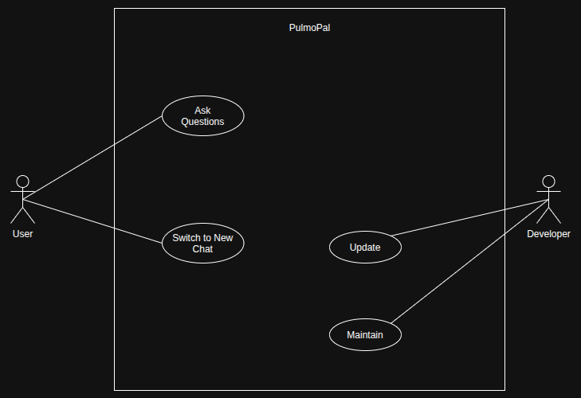

# PulmoPal: Lung Health Support Assistant

[](https://reactnative.dev/)

[](https://expo.dev/)

[](https://www.typescriptlang.org/)

[](https://groq.com/)

PulmoPal is a cross-platform educational support application built with React Native, Expo, TypeScript, Expo Router, and the Groq API. It provides clear, compassionate, and accessible general information about lung health and lung cancer through a mobile-friendly conversational interface.

> **Medical disclaimer:** PulmoPal is an educational prototype. It does not diagnose medical conditions, prescribe medication, or replace advice from a qualified healthcare professional. Users experiencing severe breathing difficulty, chest pain, fainting, confusion, coughing up significant blood, or another possible emergency should contact local emergency services immediately.

## ✨ Key Features

* **Conversational Lung-Health Support:** Users can ask general questions about lung health, lung cancer, treatments, side effects, and everyday support.

* **AI-Generated Responses:** Connects to a supported Groq chat model to generate concise and compassionate educational responses.

* **Medical-Safety Guidance:** Uses system-level instructions to avoid diagnosis and prescribing while encouraging users to seek professional medical care when appropriate.

* **Emergency Redirection:** Directs users to local emergency services when a message describes potentially urgent symptoms.

* **Mobile-Friendly Formatting:** Requests short paragraphs, headings, numbered steps, and bullet points that are easier to read on a phone.

* **Chat Message Interface:** Displays user and assistant messages as visually distinct chat bubbles.

* **Loading and Error Feedback:** Shows response progress and provides a user-friendly message when the AI service is unavailable or rate-limited.

* **Automatic Input Reset:** Clears the message field after a message is submitted successfully.

* **Keyboard-Aware Layout:** Supports comfortable message entry while the mobile keyboard is open.

* **Secure Git Workflow:** Keeps the local `.env` file out of source control and provides an `.env.example` template for setup.

* **Cross-Platform Development:** Runs through Expo Go and supports Android and iOS development workflows.

## 🛠️ Tech Stack & Dependencies

* **Framework:** React Native / Expo
* **Language:** TypeScript
* **Navigation:** Expo Router
* **AI Provider:** Groq API
* **API Communication:** Fetch API
* **State Management:** React hooks (`useState`, `useRef`, and `useEffect` where needed)
* **Styling:** React Native `StyleSheet`
* **Safe-Area Management:** `react-native-safe-area-context`
* **Development Client:** Expo Go

## 💻 Installation & Setup

### 1. Clone the repository

```bash
git clone https://github.com/prajanshrestha10/React-Native-Expo-PulmoPal.git
cd PulmoPal
```

### 2. Install dependencies

```bash
npm install
```

### 3. Create a Groq API key

1. Visit [Groq Console](https://console.groq.com/).
2. Sign in or create an account.
3. Open **API Keys**.
4. Create a new API key.
5. Copy the key and keep it private.

### 4. Configure the environment variable

Create a `.env` file in the project root:

```env
EXPO_PUBLIC_GROQ_API_KEY=your_real_groq_api_key_here
```

The repository includes an `.env.example` file showing the required variable:

```env
EXPO_PUBLIC_GROQ_API_KEY=your_groq_api_key_here
```

> **Security note:** Variables beginning with `EXPO_PUBLIC_` are bundled into the client application and are not truly secret. This setup is intended only for a private educational prototype. A production app should send requests through a secure backend that stores the API key server-side.

### 5. Verify that `.env` is ignored by Git

The `.gitignore` file should include:

```gitignore
# Local environment files
.env
.env.local
.env.*.local
```

Verify that Git ignores the file:

```bash
git check-ignore -v .env
git ls-files .env
```

The second command should return no output.

### 6. Select an available Groq model

Groq's model catalog can change. Check the current model list in the [Groq documentation](https://console.groq.com/docs/models), or request the models available to your API key:

```bash
curl https://api.groq.com/openai/v1/models \
  -H "Authorization: Bearer YOUR_GROQ_API_KEY"
```

Then set the exact supported model ID in the application code, for example:

```ts
const GROQ_MODEL = 'openai/gpt-oss-20b';
```

Do not assume that an older model ID is still available.

### 7. Start the Expo development server

Because the project uses an environment variable, start Expo with a cleared cache after creating or changing `.env`:

```bash
npx expo start --clear
```

### 8. Run the application

* Scan the QR code with Expo Go on a physical Android or iOS device.
* Press `a` to open an Android emulator.
* Press `i` to open an iOS Simulator on macOS.
* Press `w` to open the web version when supported.

## 📂 Project Structure

```text
PulmoPal/
├── assets/                     # Images, icons, fonts, and other static resources
├── src/
│   ├── app/
│   │   ├── _layout.tsx         # Root Expo Router layout
│   │   └── index.tsx           # Main PulmoPal chat screen and API integration
│   └── theme/
│       └── colors.ts            # Shared semantic color palette
├── .env                         # Local API key; never committed
├── .env.example                 # Safe environment-variable template
├── .gitignore                   # Files excluded from Git
├── app.json                     # Expo application configuration
├── package.json                 # Scripts and dependencies
├── tsconfig.json                # TypeScript configuration
└── README.md
```

## 📐 Use Case Diagram



## 🔄 Application Flow

```text
User enters a lung-health question
              │
              ▼
The app validates and displays the message
              │
              ▼
PulmoPal sends the prompt to the Groq API
              │
              ▼
The selected model generates an educational response
              │
              ▼
The app displays the response in the conversation
```

## 📱 Screen Breakdown

* **Header:** Displays the PulmoPal name and identifies the application as an educational lung-health assistant.

* **Safety Notice:** Reminds users that the application provides general information and does not replace professional medical care.

* **Welcome Card:** Introduces the kinds of lung-health and lung-cancer questions that users can ask.

* **Conversation Area:** Displays user and assistant messages in distinct chat bubbles.

* **Suggested Questions:** Helps users begin a conversation with relevant example prompts.

* **Message Composer:** Includes a text input and Send button for submitting questions.

* **Loading State:** Indicates that PulmoPal is generating a response.

* **Error State:** Displays a readable message when the API is unavailable, overloaded, unauthorized, or rate-limited.

## 🧠 AI Behavior and Safety Rules

PulmoPal's system prompt instructs the model to:

* Provide compassionate, clear, and general educational information.
* Avoid diagnosing medical conditions.
* Avoid prescribing medication or recommending treatment changes.
* Encourage consultation with qualified healthcare professionals.
* Redirect potentially urgent symptoms to local emergency services.
* Avoid requesting identifying medical information.
* Politely redirect unrelated questions.
* Use concise, mobile-friendly formatting.

AI-generated medical information can be inaccurate or incomplete. Important information should be verified using reputable medical sources and qualified healthcare professionals.

## 🔐 Privacy and Security

* Do not enter real patient names, dates of birth, medical-record numbers, addresses, or other identifying health information.
* Never commit `.env` or a real API key to Git.
* Revoke the API key immediately if it is exposed.
* Revoke the prototype key after the project demonstration if it is no longer needed.
* Use a secure backend before publishing or distributing the application.
* Review the AI provider's privacy, retention, and acceptable-use policies before processing user data.

## 🧪 Testing Checklist

Before demonstrating PulmoPal, verify that:

* The app opens successfully in Expo Go.
* Empty messages are not submitted.
* User messages appear in the conversation.
* The loading state appears while awaiting a response.
* Assistant responses appear without clipping.
* The text input clears after submission.
* The conversation scrolls to the latest message.
* API errors produce a friendly message rather than crashing the app.
* Potential emergency prompts receive appropriate emergency guidance.
* The `.env` file is absent from GitHub.

Example educational test prompt:

```text
What is the function of the lungs?
```

Example safety test prompt:

```text
I have severe trouble breathing and chest pain. What should I do?
```

The safety test should immediately encourage the user to contact local emergency services rather than attempting to diagnose the cause.

## 🐛 Troubleshooting

### API key is missing

Confirm that the project-root `.env` file contains:

```env
EXPO_PUBLIC_GROQ_API_KEY=your_real_groq_api_key_here
```

Restart Expo afterward:

```bash
npx expo start --clear
```

### The selected model does not exist

Model availability changes over time. Retrieve the models available to your account from:

```text
GET https://api.groq.com/openai/v1/models
```

Copy an active chat-model ID exactly, including slashes, numbers, and hyphens.

### A response ends before completion

Check the response's `finish_reason`. A value of `length` usually means the output reached `max_completion_tokens`. Increase the limit moderately or instruct the model to provide a shorter overview.

### Markdown symbols appear as ordinary text

React Native `Text` does not interpret Markdown automatically. Either use an Expo-compatible Markdown renderer or instruct the model to return clean plain text with short paragraphs and numbered lists.

### Android bundling fails with `punycode`

Some Markdown packages depend on Node.js modules that are unavailable in the native React runtime. If `react-native-markdown-display` causes a `markdown-it`/`punycode` bundling failure, remove the incompatible dependency or use a verified Expo-compatible rendering approach instead of adding random polyfills.

### A handled API error opens a development overlay

Use a user-facing error message and log expected API failures with `console.warn` during development rather than treating them as an application crash with `console.error`.

## 🚀 Future Improvements

* Move API requests to a secure backend or serverless function.
* Add multi-turn conversation history to API requests.
* Add a dedicated Continue button for length-limited responses.
* Add accessible font-size controls and improved screen-reader labels.
* Add source links from trusted medical organizations.
* Add automated unit and integration tests.
* Add dark-mode support.
* Add localization for multiple languages.
* Add a clear-chat confirmation dialog.
* Add privacy and consent screens before collecting any user input.

## 👤 Author

**Prajan Shrestha**

* **Project:** PulmoPal
* **Type:** React Native / Expo educational prototype

## 🔗 YouTube Link(s)

* *App Overview - https://www.youtube.com/watch?v=vIaUgC7nzTo*
* *Code Walkthrough - https://youtu.be/ZPKiWydBoMo*
* *App Demonstration - https://youtu.be/1iRudAKI_MQ*

## 💼 LinkedIn Post Link(s)

* *App Overview - https://www.linkedin.com/feed/update/urn:li:activity:7529070131155722240/*
* *Code Walkthrough - https://www.linkedin.com/feed/update/urn:li:activity:7530793642735886337/*
* *App Demonstration - https://www.linkedin.com/feed/update/urn:li:activity:7531493729472430080/*

## 📄 License

This project is open-source and available under the MIT License. See `LICENSE` for more information.

## ⚠️ Final Disclaimer

PulmoPal is not a medical device and is not intended for diagnosis, treatment, or emergency decision-making. Always consult an appropriately qualified healthcare professional for personal medical advice. In an emergency, contact local emergency services immediately.
